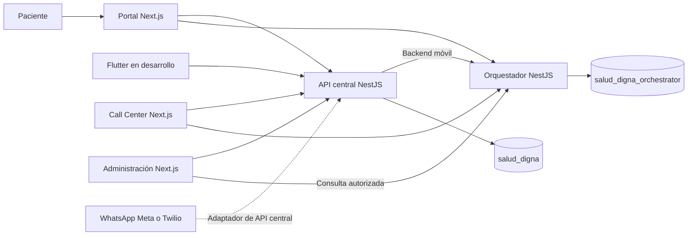
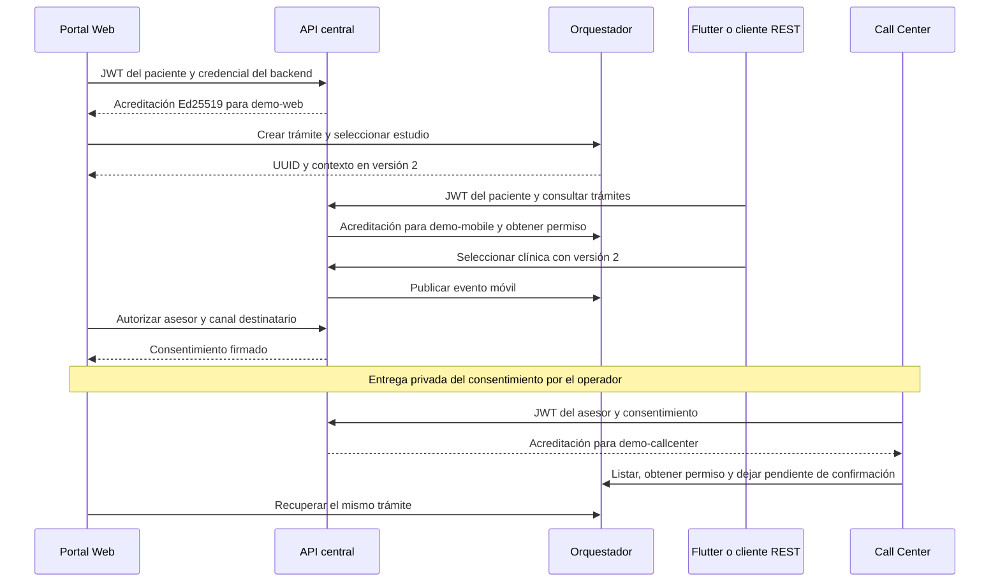
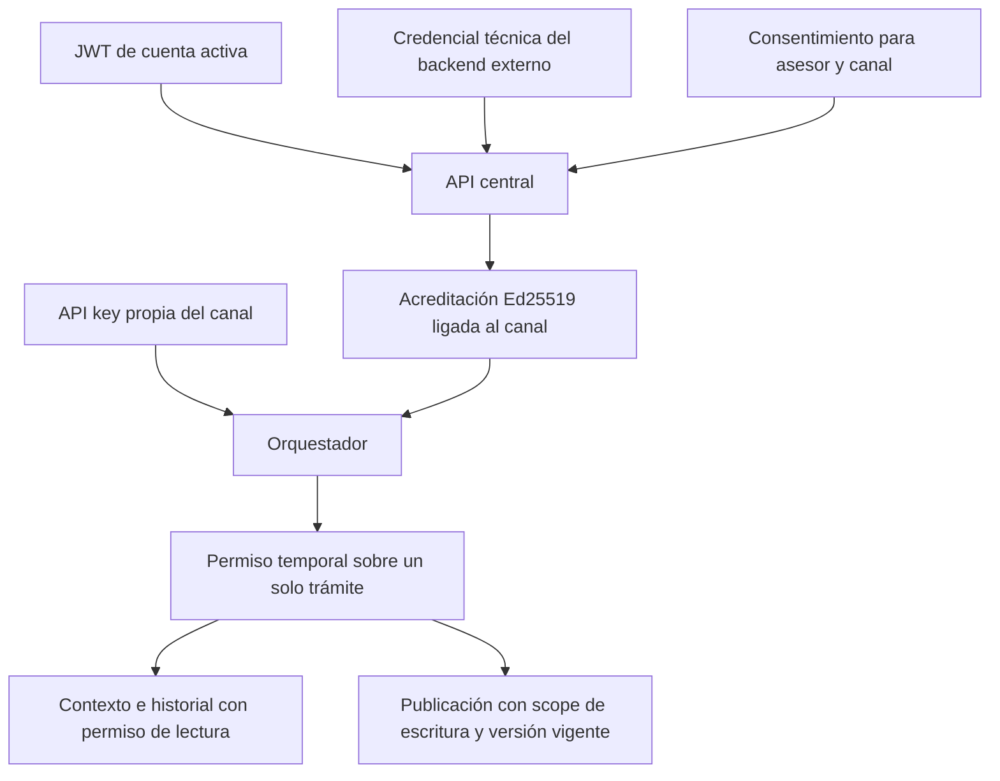
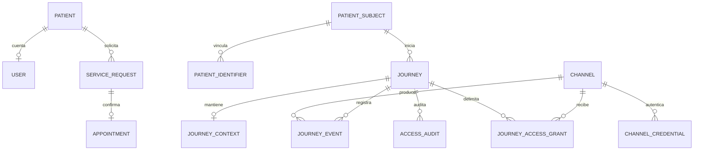

# Salud Digna · Hackatec Nacional 2026

Prototipo académico de continuidad omnicanal para la atención al paciente. Usa
datos sintéticos y carece de relación operativa con el sistema oficial de
Salud Digna. Las cuentas y tarifas de ejemplo son ficticias.

Al cambiar de canal, el paciente puede verse obligado a repetir datos y
selecciones porque cada aplicación conserva su propio contexto. Este prototipo
mantiene un trámite común y su historial en un orquestador. La identidad
institucional permite reconocer al paciente, los permisos acotan el acceso al
trámite y la auditoría registra las consultas. Cada canal integra el mismo
contrato REST desde su propia tecnología.

## Guía rápida para evaluadores

La demo sigue un trámite desde el Portal Web hasta el backend móvil REST
y Call Center. Administración consulta el mismo contexto e historial.
El resultado esperado es un único UUID con estudio y clínica conservados,
paso `REVIEW` y estado `PENDING_CONFIRMATION`.

- **Aplicaciones disponibles:** Portal Web, Call Center, Administración,
  API central, orquestador y backend móvil REST. Los comandos REST
  permiten seguir la demo mientras Flutter está en desarrollo.
- **Antes de iniciar:** sigue [Requisitos e instalación](#requisitos-e-instalación)
  y aprovisiona las [cuentas sintéticas](#cuentas-de-evaluación).
- **Durante la evaluación:** sigue la
  [demostración institucional](#demostración-web--móvil--call-center)
  y compara con el [resultado de referencia](#6-resultado-de-referencia-y-persistencia).

## Índice

1. [Arquitectura y estructura](#arquitectura-y-estructura)
2. [Requisitos e instalación](#requisitos-e-instalación)
3. [Cuentas de evaluación](#cuentas-de-evaluación)
4. [Arranque de las aplicaciones](#arranque-de-las-aplicaciones)
5. [Demostración Web → Móvil → Call Center](#demostración-web--móvil--call-center)
6. [Verificación y solución de problemas](#verificación-y-solución-de-problemas)
7. [Estado y entorno de referencia](#estado-y-entorno-de-referencia)
8. [Limpieza de la VM](#limpieza-de-la-vm)

## Arquitectura y estructura

| Ruta | Responsabilidad |
| --- | --- |
| [`apps/api`](apps/api/) | API central NestJS. Cuentas, UUID institucional del paciente, acreditaciones Ed25519, catálogos, solicitudes y citas centrales. Aloja el backend móvil REST. |
| [`apps/orchestrator`](apps/orchestrator/) | Servicio NestJS independiente. Identidad omnicanal, trámites, contexto versionado, eventos, permisos, códigos alternativos de continuidad y auditoría. |
| [`apps/patient-portal`](apps/patient-portal/) | Portal Next.js. El servidor del portal consume la API central y el orquestador. |
| [`apps/call-center`](apps/call-center/) | Consola Next.js para recuperar y continuar una atención autorizada. |
| [`apps/admin`](apps/admin/) | Consola Next.js de administración y monitoreo. En esta demo supervisa contexto e historial con permiso de lectura. |
| [`apps/operations`](apps/operations/) | Marcador histórico. Las consolas operativas se ejecutan desde sus paquetes propios. |
| [`packages/contracts`](packages/contracts/) y [`packages/shared`](packages/shared/) | Directorios sin paquetes ejecutables en esta revisión. Los contratos publicados están en `docs/`. |
| [`docs`](docs/) | Contratos, decisiones y procedimientos. |

La aplicación Flutter está en desarrollo fuera de este monorepo. Para continuidad
móvil solo llama a la API central con el JWT del paciente. La API central invoca
el orquestador desde el servidor. Las bases PostgreSQL son independientes y el
orquestador verifica las acreditaciones de forma local con la clave pública,
sin consultar la API central o su base.

La API central incluye adaptadores de WhatsApp para Meta y Twilio con webhooks
verificados y procesamiento de mensajes. Requieren un proveedor habilitado y
sus credenciales. La validación integral de WhatsApp en el escenario
institucional de este README sigue pendiente. [Integración WhatsApp](docs/integrations/whatsapp.md)









`Patient.id` es el `CUSTOMER_ID` estable de la API central. El orquestador
guarda su HMAC en su propio espacio de nombres y asocia el resultado a un
`PatientSubject`. El vínculo entre servicios se establece por la acreditación
firmada.

## Requisitos e instalación

Usa una **VM Debian 13 aislada**, con acceso de lectura al repositorio y
una cuenta normal con `sudo`. Reserva los puertos locales 3000, 3300, 5173,
3001, 3002 y 443 para esta instalación. Ejecuta los bloques Bash desde la
raíz del clon y conserva la terminal que define `DEMO_DIR` para los pasos
de aprovisionamiento. Los comandos con `sudo` son administrativos y se
ejecutan exclusivamente en esa VM.

| Componente | Versión |
| --- | --- |
| Node.js y pnpm | 24.22.3 y 11.28.11 |
| PostgreSQL | 17 |
| NestJS y Prisma | 11.2.7 y 7.9.1, con `@prisma/adapter-pg` 7.9.1 |
| TypeScript, Next.js y React | 5.9.3, 16.4.6 y 19.3.1 |
| Herramientas | Git, curl, jq, OpenSSL, certificados CA, xz y Nginx para la prueba TLS local |

### Herramientas y clon

```bash
set -eo pipefail
sudo apt update
sudo apt install git curl jq openssl ca-certificates xz-utils iproute2 postgresql-17 nginx

case "$(uname -m)" in
  x86_64) node_arch=x64 ;;
  aarch64) node_arch=arm64 ;;
  *) printf '%s\n' 'Usa la distribución oficial de Node.js 24.22.3 de tu arquitectura.' >&2; exit 1 ;;
esac
node_release="node-v24.22.3-linux-$node_arch"
node_tmp=$(mktemp -d)
(
  cd "$node_tmp" &&
  curl -fsSLO "https://nodejs.org/dist/v24.22.3/$node_release.tar.xz" &&
  curl -fsSLO https://nodejs.org/dist/v24.22.3/SHASUMS256.txt &&
  grep " $node_release.tar.xz$" SHASUMS256.txt | sha256sum -c - &&
  sudo tar --no-same-owner -xJf "$node_release.tar.xz" -C /opt
)
rm -- "$node_tmp/$node_release.tar.xz" "$node_tmp/SHASUMS256.txt"
rmdir -- "$node_tmp"
NODE_BIN="/opt/$node_release/bin"
export PATH="$NODE_BIN:$PATH"
sudo env PATH="$PATH" "$NODE_BIN/corepack" enable --install-directory "$NODE_BIN"
corepack install --global pnpm@11.28.11
node --version
pnpm --version
git --version
psql --version
openssl version

git clone https://github.com/jangeltr/salud-digna.git
cd salud-digna
pnpm install --frozen-lockfile
```

Si el repositorio solicita autenticación, usa el acceso de lectura entregado
para la evaluación. Deja las credenciales de Git fuera de la URL.
En cada terminal nueva añade al `PATH` el mismo directorio `bin`
instalado en `/opt`. Usa `/opt/node-v24.22.3-linux-x64/bin` en x86-64 o
`/opt/node-v24.22.3-linux-arm64/bin` en ARM64.

### Comprobación previa y preparación sin conexión

Mantén `set -eo pipefail` en la terminal de aprovisionamiento durante
los pasos de instalación y la demo. Ante cualquier error, detente y
resuelve la causa antes de ejecutar otro bloque. `apt` puede arrancar
Nginx automáticamente. Si un servicio ocupa un puerto requerido, usa
otra VM aislada o coordina ese puerto con su responsable. Este
procedimiento deja intactos los servicios que ya existían.

```bash
for tool in git curl jq openssl xz tar sha256sum node corepack pnpm psql pg_isready \
  pg_lsclusters systemctl ss ip getent awk sed cmp sudo nginx; do
  command -v "$tool" >/dev/null || { printf 'Falta %s\n' "$tool" >&2; exit 1; }
done
test "$(node --version)" = v24.22.3
test "$(pnpm --version)" = 11.28.11
sudo systemctl is-active nginx || true
listeners=$(ss -H -ltn '( sport = :3000 or sport = :3300 or sport = :5173 or sport = :3001 or sport = :3002 or sport = :443 )')
if test -n "$listeners"; then
  printf 'Hay puertos de demo ocupados:\n%s\n' "$listeners" >&2
  exit 1
fi

check_demo_hosts_absent() {
  awk '
    /# demo-hackatec-local$/ { print; conflict=1; next }
    { sub(/#.*/, ""); for (i=2; i<=NF; i++)
      if (tolower($i) ~ /^(api|orchestrator)[.]salud-digna[.]app[.]?$/) { print; conflict=1; break } }
    END { exit conflict ? 1 : 0 }
  ' /etc/hosts
}
check_demo_hosts_absent
test ! -e /etc/salud-digna-hackatec && test ! -L /etc/salud-digna-hackatec || exit 1
test ! -e /var/lib/salud-digna-callcenter && test ! -L /var/lib/salud-digna-callcenter || exit 1
if getent passwd salud-digna-callcenter >/dev/null || getent group salud-digna-callcenter >/dev/null; then
  printf '%s\n' 'El usuario o grupo de servicio ya existe. Usa una VM limpia.' >&2
  exit 1
fi
```

Prepara la copia de Call Center y su caché de pnpm mientras la VM todavía
tiene conexión para descargar dependencias. Su proceso usará ese mismo
usuario y grupo primario durante la demo.

```bash
umask 077
DEMO_DIR=$(mktemp -d /tmp/salud-digna-hackatec.XXXXXXXX)
REPO=$PWD
LOCAL_CA=/etc/salud-digna-hackatec/loopback.crt
CONSENT_DIR=/var/lib/salud-digna-callcenter/consents

sudo groupadd --system salud-digna-callcenter
sudo useradd --system --gid salud-digna-callcenter --create-home \
  --shell /bin/bash salud-digna-callcenter
CC_REPO="$(getent passwd salud-digna-callcenter | cut -d: -f6)/salud-digna"
sudo install -d -o salud-digna-callcenter -g salud-digna-callcenter -m 0750 "$CC_REPO"
git archive HEAD | sudo -u salud-digna-callcenter tar -x -C "$CC_REPO"
sudo -H -u salud-digna-callcenter env PATH="$NODE_BIN:/usr/bin:/bin" bash -ec '
  cd "$1"
  test "$(node --version)" = v24.22.3
  corepack --version
  corepack install --global pnpm@11.28.11
  test "$(pnpm --version)" = 11.28.11
  pnpm install --frozen-lockfile
' bash "$CC_REPO"

declare -p NODE_BIN REPO LOCAL_CA CC_REPO CONSENT_DIR > "$DEMO_DIR/terminal.env"
printf 'Directorio para abrir las demás terminales: %s\n' "$DEMO_DIR"

cat > "$DEMO_DIR/offline.bash" <<'BASH'
unset HTTP_PROXY HTTPS_PROXY ALL_PROXY http_proxy https_proxy all_proxy NODE_USE_ENV_PROXY
interfaces=$(ip -o link show up | awk -F': ' '$2 != "lo" { print $2 }') || exit 1
routes4=$(ip -4 route show default) || exit 1
routes6=$(ip -6 route show default) || exit 1
if test -n "$interfaces$routes4$routes6"; then
  printf '%s\n' 'Detén la demo: la VM todavía tiene interfaces externas activas o rutas por defecto.' >&2
  exit 1
fi
BASH
```

Para abrir una terminal nueva de servicio, usa Bash con la cuenta normal
y carga el archivo privado de rutas. Ejecuta solo el proceso indicado
en la [tabla de terminales](#terminales).

```bash
set -eo pipefail
read -r -p 'Directorio de demo que imprimió aprovisionamiento: ' DEMO_DIR
test -O "$DEMO_DIR/terminal.env"
source "$DEMO_DIR/terminal.env"
source "$DEMO_DIR/offline.bash"
export PATH="$NODE_BIN:$PATH"
cd "$REPO"
```

**Desconecta los adaptadores de red de la VM desde el hipervisor y continúa
desde su consola local.** Solo `lo` debe quedar activo. Si una interfaz
externa sigue activa, revisa la configuración de esa VM antes de seguir.
Mantén el aislamiento hasta terminar la limpieza. El navegador también
debe ejecutarse dentro de la VM.

```bash
source "$DEMO_DIR/offline.bash"
sudo systemctl start postgresql
sudo systemctl is-active --quiet postgresql
pg_lsclusters
pg_isready -h 127.0.0.1 -p 5432
pg_local() { sudo -u postgres psql -X -v ON_ERROR_STOP=1 -h /var/run/postgresql -p 5432 -d postgres "$@"; }
pg_version=$(pg_local -Atc 'SHOW server_version_num')
test "$pg_version" -ge 170000 && test "$pg_version" -lt 180000 || exit 1
conflicts=$(pg_local -At <<'SQL'
SELECT 'base: ' || datname FROM pg_database
WHERE datname IN ('salud_digna', 'salud_digna_orchestrator')
UNION ALL
SELECT 'rol: ' || rolname FROM pg_roles
WHERE rolname IN ('salud_digna_app', 'salud_digna_orchestrator_app');
SQL
)
if test -n "$conflicts"; then
  printf 'Conflictos en PostgreSQL local:\n%s\n' "$conflicts" >&2
  exit 1
fi
```

### PostgreSQL y archivos privados

Los roles locales son propietarios de sus bases y pueden crear los objetos
de su propio esquema `public` al aplicar el historial versionado. Ejecuta el
alta solo en una instalación nueva. Si alguna base o rol ya existe, verifica
el destino antes de continuar.

```bash
source "$DEMO_DIR/offline.bash"
unset DATABASE_URL ORCHESTRATOR_DB_HOST ORCHESTRATOR_DB_PORT
API_DB_PASSWORD=$(openssl rand -hex 24)
ORCH_DB_PASSWORD=$(openssl rand -hex 24)

pg_local <<SQL
CREATE ROLE salud_digna_app LOGIN PASSWORD '$API_DB_PASSWORD';
CREATE ROLE salud_digna_orchestrator_app LOGIN PASSWORD '$ORCH_DB_PASSWORD';
CREATE DATABASE salud_digna OWNER salud_digna_app;
CREATE DATABASE salud_digna_orchestrator OWNER salud_digna_orchestrator_app;
SQL
pg_local -d salud_digna \
  -c 'GRANT USAGE, CREATE ON SCHEMA public TO salud_digna_app'
pg_local -d salud_digna_orchestrator \
  -c 'GRANT USAGE, CREATE ON SCHEMA public TO salud_digna_orchestrator_app'

cp -n apps/api/.env.example apps/api/.env
cp -n apps/orchestrator/.env.example apps/orchestrator/.env
cp -n apps/patient-portal/.env.example apps/patient-portal/.env.local
chmod 600 apps/api/.env apps/orchestrator/.env apps/patient-portal/.env.local
```

Para el clon nuevo, escribe la configuración local en los dos archivos
privados. La URL del orquestador exige usuario, base, contraseña, host y
puerto explícitos. Rechaza parámetros y fragmentos. Los secretos generados
aquí se guardan fuera de Git.

```bash
openssl genpkey -algorithm ED25519 -out "$DEMO_DIR/issuer.pem"
openssl pkey -in "$DEMO_DIR/issuer.pem" -pubout -out "$DEMO_DIR/issuer.pub.pem"
random_key() { node -e 'process.stdout.write(require("node:crypto").randomBytes(32).toString("base64url"))'; }
random_key > "$DEMO_DIR/web-issuer.key"
random_key > "$DEMO_DIR/callcenter-issuer.key"
issuer_channels=$(node - "$DEMO_DIR" <<'NODE'
const { createHash } = require('node:crypto');
const { readFileSync } = require('node:fs');
const { join } = require('node:path');
const digest = (name) => createHash('sha256')
  .update(Buffer.from(readFileSync(join(process.argv[2], name), 'utf8'), 'base64url')).digest('hex');
process.stdout.write(JSON.stringify({
  'demo-web': { role: 'PATIENT', secretDigest: digest('web-issuer.key') },
  'demo-callcenter': { role: 'ADVISOR', secretDigest: digest('callcenter-issuer.key') },
}));
NODE
)
{
  printf '%s\n' NODE_ENV=development API_HOST=127.0.0.1 API_PORT=3000 WHATSAPP_ENABLED=false
  printf 'CORS_ORIGINS=%s\n' 'http://127.0.0.1:5173,http://127.0.0.1:3001,http://127.0.0.1:3002'
  printf 'DATABASE_URL=postgresql://salud_digna_app:%s@127.0.0.1:5432/salud_digna?schema=public\n' "$API_DB_PASSWORD"
  printf 'JWT_SECRET=%s\n' "$(openssl rand -hex 32)"
  printf 'PATIENT_ASSERTION_PRIVATE_KEY="%s"\n' "$(cat "$DEMO_DIR/issuer.pem")"
  printf "PATIENT_ASSERTION_CHANNELS='%s'\n" "$issuer_channels"
} > apps/api/.env
{
  printf '%s\n' ORCHESTRATOR_PORT=3300 ORCHESTRATOR_DB_HOST=127.0.0.1 ORCHESTRATOR_DB_PORT=5432
  printf 'DATABASE_URL=postgresql://salud_digna_orchestrator_app:%s@127.0.0.1:5432/salud_digna_orchestrator\n' "$ORCH_DB_PASSWORD"
  printf 'ORCHESTRATOR_CENTRAL_ASSERTION_PUBLIC_KEY="%s"\n' "$(cat "$DEMO_DIR/issuer.pub.pem")"
  printf 'ORCHESTRATOR_PATIENT_IDENTITY_KEY=%s\n' "$(random_key)"
  printf 'ORCHESTRATOR_CONTINUITY_HMAC_KEY=%s\n' "$(random_key)"
} > apps/orchestrator/.env
```

### Migraciones, compilación y canales

Ejecuta como usuario normal desde el clon local. Los dos comandos de
migración usan sus respectivos archivos `.env` y los historiales versionados.

```bash
pnpm --filter @salud-digna/api prisma:migrate:deploy
pnpm --filter @salud-digna/orchestrator prisma:migrate:deploy
pnpm --filter @salud-digna/api prisma:generate
pnpm --filter @salud-digna/orchestrator prisma:generate
pnpm --filter @salud-digna/api build
pnpm --filter @salud-digna/orchestrator build
pnpm --filter @salud-digna/api catalogs:seed-demo
```

Los builds también generan los clientes Prisma. La carga inserta tres
clínicas y cinco estudios sintéticos. Registra los canales en la base local
del orquestador. La CLI de credenciales exige un canal activo preexistente.

```bash
PGPASSWORD="$ORCH_DB_PASSWORD" psql -X -v ON_ERROR_STOP=1 \
  -h 127.0.0.1 -p 5432 -U salud_digna_orchestrator_app -d salud_digna_orchestrator <<'SQL'
INSERT INTO "Channel" ("code", "name")
VALUES ('demo-web', 'Web demo'), ('demo-mobile', 'Móvil demo'),
       ('demo-callcenter', 'Call Center demo'), ('demo-admin', 'Administración demo')
ON CONFLICT ("code") DO NOTHING;
SQL

(
  cd apps/orchestrator || exit
  for channel in demo-web demo-mobile demo-callcenter; do
    node dist/channel-auth/create-channel-credential.js --channel "$channel" \
      --scope JOURNEYS_READ --scope EVENTS_PUBLISH > "$DEMO_DIR/$channel.key" || exit
  done
  node dist/channel-auth/create-channel-credential.js --channel demo-admin \
    --scope JOURNEYS_READ > "$DEMO_DIR/demo-admin.key"
)
{
  printf '%s\n' MOBILE_ORCHESTRATOR_ORIGIN=http://127.0.0.1:3300
  printf 'MOBILE_ORCHESTRATOR_API_KEY=%s\n' "$(cat "$DEMO_DIR/demo-mobile.key")"
} >> apps/api/.env
```

La invocación directa del JavaScript compilado es la misma CLI que ejecuta
`auth:create-channel-credential`. La redirección guarda solo su salida, sin
el encabezado de pnpm. Las claves de canal no se copian a Flutter ni a
variables `NEXT_PUBLIC_*`.

## Cuentas de evaluación

**Contraseñas públicas de prueba.** Úsalas exclusivamente en la instalación
local aislada con datos sintéticos. Nunca las reutilices en producción.
Estas cuentas deben aprovisionarse en el clon local.

| Rol | Correo | Contraseña |
| --- | --- | --- |
| PATIENT | paciente1@example.com | Hackatec2026Paciente1! |
| PATIENT | paciente2@example.com | Hackatec2026Paciente2! |
| PATIENT | paciente3@example.com | Hackatec2026Paciente3! |
| ADVISOR | asesor@example.com | Hackatec2026Asesor! |
| ADMIN | admin@example.com | Hackatec2026Admin! |

Arranca cada backend en una terminal distinta, después de cargar las rutas
compartidas y comprobar la red aislada. Cada uno usa su archivo `.env` local:

```bash
pnpm --filter @salud-digna/api start
```

```bash
pnpm --filter @salud-digna/orchestrator start
```

En la terminal de aprovisionamiento, registra los pacientes. Los cuerpos
incluyen todos los campos necesarios y `phone` es opcional.

```bash
API=http://127.0.0.1:3000/api/v1
ORCH=http://127.0.0.1:3300/api/v1
curl -fsS "$API/health"
curl -fsS "$ORCH/health"

curl -fsS "$API/auth/register" -H 'Content-Type: application/json' -d \
  '{"firstName":"Paciente","lastName":"Sintético Uno","email":"paciente1@example.com","password":"Hackatec2026Paciente1!"}' |
  jq -e 'select(.role == "PATIENT" and (.patientId | type == "string")) | {email,role,patientId}'
curl -fsS "$API/auth/register" -H 'Content-Type: application/json' -d \
  '{"firstName":"Paciente","lastName":"Sintético Dos","email":"paciente2@example.com","password":"Hackatec2026Paciente2!"}' |
  jq -e 'select(.role == "PATIENT" and (.patientId | type == "string")) | {email,role,patientId}'
curl -fsS "$API/auth/register" -H 'Content-Type: application/json' -d \
  '{"firstName":"Paciente","lastName":"Sintético Tres","email":"paciente3@example.com","password":"Hackatec2026Paciente3!"}' |
  jq -e 'select(.role == "PATIENT" and (.patientId | type == "string")) | {email,role,patientId}'
```

Crea el personal con las herramientas interactivas, sin argumentos ni
redirecciones. Cuando se solicite la confirmación, repite exactamente la
contraseña de la fila correspondiente. La terminal oculta la entrada.

```bash
pnpm --filter @salud-digna/api auth:create-advisor
pnpm --filter @salud-digna/api auth:create-admin
```

| Comando | Correo solicitado | Contraseña y confirmación |
| --- | --- | --- |
| `auth:create-advisor` | `asesor@example.com` | `Hackatec2026Asesor!` en ambos prompts |
| `auth:create-admin` | `admin@example.com` | `Hackatec2026Admin!` en ambos prompts |

Comprueba las cinco sesiones sin imprimir los JWT. Los archivos de sesión
quedan en `DEMO_DIR` con permisos privados. Ejecuta el bloque completo y
espera entre grupos si la API devuelve `429` con `Retry-After`.

```bash
login_demo() {
  local name=$1 email=$2 password=$3 role=$4
  rm -f -- "$DEMO_DIR/$name.headers" "$DEMO_DIR/$name.headers.pending" "$DEMO_DIR/$name.jwt" \
    "$DEMO_DIR/$name.login.json" || return 1
  jq -nc --arg email "$email" --arg password "$password" '{email:$email,password:$password}' |
    curl -fsS "$API/auth/login" -H 'Content-Type: application/json' --data-binary @- \
      > "$DEMO_DIR/$name.login.json" || return 1
  jq -er --arg role "$role" 'select(.user.role == $role) | .accessToken | strings | select(length > 0)' \
    "$DEMO_DIR/$name.login.json" > "$DEMO_DIR/$name.jwt" || return 1
  printf 'Authorization: Bearer %s\n' "$(cat "$DEMO_DIR/$name.jwt")" \
    > "$DEMO_DIR/$name.headers.pending" || return 1
  curl -fsS "$API/auth/me" -H @"$DEMO_DIR/$name.headers.pending" |
    jq -e --arg role "$role" --arg email "$email" \
      'select(.role == $role and .email == $email and .isActive == true and (.id | type == "string"))
       | {id,email,role,patientId}' || return 1
  mv -T -- "$DEMO_DIR/$name.headers.pending" "$DEMO_DIR/$name.headers"
}
login_demo p1 paciente1@example.com 'Hackatec2026Paciente1!' PATIENT || exit 1
login_demo p2 paciente2@example.com 'Hackatec2026Paciente2!' PATIENT || exit 1
login_demo p3 paciente3@example.com 'Hackatec2026Paciente3!' PATIENT || exit 1
login_demo advisor asesor@example.com 'Hackatec2026Asesor!' ADVISOR || exit 1
login_demo admin admin@example.com 'Hackatec2026Admin!' ADMIN || exit 1
```

Cada renovación elimina el encabezado anterior. La función publica el
nuevo archivo de encabezados solo después de verificar cuenta, correo
y rol en `/auth/me`. Si falla una autenticación, detente antes de
usar los pasos siguientes. Las sesiones de navegador son independientes
de estos JWT. Vuelve a iniciar sesión en la interfaz local si caduca.

Cada respuesta de `/auth/me` confirma el rol. Para un paciente, `patientId`
es el `CUSTOMER_ID`. Para asesor y administrador, usa `id`, el UUID de la
cuenta. Introduce únicamente estas credenciales sintéticas en las
interfaces locales de la demo.

## Arranque de las aplicaciones

### Nombres HTTPS en la VM local

El backend Next.js de Call Center exige el origen institucional
`https://api.salud-digna.app` y ambas consolas usan el origen fijo
`https://orchestrator.salud-digna.app`. Para reproducirlas sin acceder al
despliegue, resuelve **esos dos nombres a loopback en la VM aislada** y
sirve TLS local. Las consolas validan normalmente los certificados. Los
navegadores llaman a la API local en `http://127.0.0.1:3000` para el login.

Ejecuta el bloque en aprovisionamiento con la VM desconectada. El proceso
Nginx es independiente del servicio de sistema. Si IPv6 está disponible
en loopback, también se configura `::1`.

```bash
source "$DEMO_DIR/offline.bash"
https_listener=$(ss -H -ltn 'sport = :443')
test -z "$https_listener"
check_demo_hosts_absent
test ! -e "$LOCAL_CA" && test ! -L "$LOCAL_CA" || exit 1
sudo install -d -o root -g root -m 0755 /etc/salud-digna-hackatec
openssl req -x509 -newkey rsa:2048 -noenc -days 2 \
  -subj '/CN=api.salud-digna.app' \
  -addext 'subjectAltName=DNS:api.salud-digna.app,DNS:orchestrator.salud-digna.app' \
  -addext 'basicConstraints=critical,CA:TRUE' \
  -keyout "$DEMO_DIR/loopback.key" -out "$DEMO_DIR/loopback.crt"
sudo install -m 0644 "$DEMO_DIR/loopback.crt" "$LOCAL_CA"
V6_LISTEN=
ipv6_lo=$(ip -o -6 addr show dev lo scope host)
if [[ "$ipv6_lo" == *'::1/128'* ]]; then
  V6_LISTEN='listen [::1]:443 ssl;'
fi

cat > "$DEMO_DIR/nginx.conf" <<NGINX
pid $DEMO_DIR/nginx.pid;
error_log $DEMO_DIR/nginx-error.log;
events {}
http {
  access_log off;
  ssl_certificate $DEMO_DIR/loopback.crt;
  ssl_certificate_key $DEMO_DIR/loopback.key;
  server {
    listen 127.0.0.1:443 ssl;
    $V6_LISTEN
    server_name api.salud-digna.app;
    location / { proxy_pass http://127.0.0.1:3000; }
  }
  server {
    listen 127.0.0.1:443 ssl;
    $V6_LISTEN
    server_name orchestrator.salud-digna.app;
    location / { proxy_pass http://127.0.0.1:3300; }
  }
}
NGINX
sudo nginx -t -p "$DEMO_DIR/" -c "$DEMO_DIR/nginx.conf"
sudo nginx -p "$DEMO_DIR/" -c "$DEMO_DIR/nginx.conf"
{
  printf '\n127.0.0.1 api.salud-digna.app orchestrator.salud-digna.app # demo-hackatec-local\n'
  if test -n "$V6_LISTEN"; then
    printf '::1 api.salud-digna.app orchestrator.salud-digna.app # demo-hackatec-local\n'
  fi
} | sudo tee -a /etc/hosts >/dev/null
declare -p V6_LISTEN >> "$DEMO_DIR/terminal.env"

cat > "$DEMO_DIR/verify-https.bash" <<'BASH'
source "$DEMO_DIR/offline.bash"
cmp -s "$LOCAL_CA" "$DEMO_DIR/loopback.crt" || exit 1
https_listeners=$(ss -H -ltn 'sport = :443') || exit 1
awk -v ipv6="$V6_LISTEN" '
  NF {
    if ($4 == "127.0.0.1:443") v4=1
    else if ($4 == "[::1]:443" && ipv6 != "") v6=1
    else bad=1
  }
  END { exit bad || !v4 || (ipv6 != "" && !v6) }
' <<< "$https_listeners" || exit 1
node - "$V6_LISTEN" <<'NODE' || exit 1
const { lookup } = require('node:dns/promises');
const allowed = new Set(['127.0.0.1', ...(process.argv[2] ? ['::1'] : [])]);
Promise.all(['api.salud-digna.app', 'orchestrator.salud-digna.app'].map(async (host) => {
  const addresses = (await lookup(host, { all: true })).map(({ address }) => address);
  if (!addresses.includes('127.0.0.1') || addresses.some((address) => !allowed.has(address))) {
    throw new Error(host + ' no resuelve exclusivamente al loopback configurado');
  }
  console.log(host, [...new Set(addresses)].join(', '));
})).catch((error) => { console.error(error.message); process.exitCode = 1; });
NODE

for port in 3000 3300; do
  curl -fsS --noproxy '*' --max-time 5 "http://127.0.0.1:$port/api/v1/health" |
    jq -e '.status == "ok"' >/dev/null || exit 1
done
addresses=127.0.0.1
if test -n "$V6_LISTEN"; then addresses='127.0.0.1 [::1]'; fi
for address in $addresses; do
  for host in api.salud-digna.app orchestrator.salud-digna.app; do
    curl -fsS --noproxy '*' --max-time 5 --cacert "$LOCAL_CA" --resolve "$host:443:$address" \
      "https://$host/api/v1/health" | jq -e '.status == "ok"' >/dev/null || exit 1
  done
  curl -fsS --noproxy '*' --max-time 5 --cacert "$LOCAL_CA" \
    --resolve "api.salud-digna.app:443:$address" https://api.salud-digna.app/api/v1/health/db |
    jq -e '.status == "ok"' >/dev/null || exit 1
done
BASH
source "$DEMO_DIR/verify-https.bash"
```

Si falla una comprobación, el bloque termina antes de arrancar las
consolas. No abras las URLs informativas del despliegue para resolver
un error local. Conserva la VM sin red exterior y valida el certificado
durante toda la demo.

### Portal y Administración

Configura los archivos privados antes de arrancar. El portal usa HTTP
solo para backends locales de loopback. Administración verifica su sesión
contra la API central y consulta al orquestador por HTTPS local.

```bash
{
  printf '%s\n' API_BASE_URL=http://127.0.0.1:3000/api/v1 REQUESTS_BACKEND=orchestrator \
    PATIENT_IDENTITY_MODE=assertion ORCHESTRATOR_BASE_URL=http://127.0.0.1:3300/api/v1
  printf 'ORCHESTRATOR_API_KEY=%s\n' "$(cat "$DEMO_DIR/demo-web.key")"
  printf 'PATIENT_ASSERTION_CHANNEL_KEY=%s\n' "$(cat "$DEMO_DIR/web-issuer.key")"
} > apps/patient-portal/.env.local

{
  printf '%s\n' NEXT_PUBLIC_GENERAL_API_ORIGIN=http://127.0.0.1:3000 \
    GENERAL_API_ORIGIN=https://api.salud-digna.app STAFF_FRONTEND_ORIGIN=http://127.0.0.1:3002
  printf 'ADMIN_ORCHESTRATOR_API_KEY=%s\n' "$(cat "$DEMO_DIR/demo-admin.key")"
} > apps/admin/.env.local
```

En terminales separadas, desde el clon:

```bash
source "$DEMO_DIR/verify-https.bash"
pnpm --filter @salud-digna/patient-portal dev
```

```bash
source "$DEMO_DIR/verify-https.bash"
NODE_EXTRA_CA_CERTS="$LOCAL_CA" pnpm --filter @salud-digna/admin dev
```

Abre Portal en `http://127.0.0.1:5173` y Administración en
`http://127.0.0.1:3002`.

### Call Center y custodia del consentimiento

El lector requiere Linux con `/proc/self/fd` y un proceso no root con
UID y GID real y efectivo coincidentes. Usa el grupo primario
`salud-digna-callcenter`. El directorio de consentimientos debe quedar
fuera del worktree, tener propietario `root:salud-digna-callcenter` y
modo `0750`. Todos los directorios superiores deben ser de root y carecer
de escritura para el grupo u otros. Usa rutas sin enlaces simbólicos y
sin ACL que amplíen el acceso. El archivo regular se llama
`<UUID de cuenta ADVISOR en minúsculas>.jws`, lleva el mismo propietario
y grupo, modo `0640` y contiene solo el JWS compacto de consentimiento
de hasta 2048 caracteres. El lector verifica cada componente mediante
los descriptores de archivo y rechaza enlaces simbólicos.
El proceso puede leerlo, y el operador con privilegios controla su entrega.

Configura la copia de Call Center que ya preparaste desde aprovisionamiento.

```bash
sudo install -d -o root -g root -m 0755 /var/lib/salud-digna-callcenter
sudo install -d -o root -g salud-digna-callcenter -m 0750 "$CONSENT_DIR"

{
  printf '%s\n' NEXT_PUBLIC_GENERAL_API_ORIGIN=http://127.0.0.1:3000 \
    GENERAL_API_ORIGIN=https://api.salud-digna.app STAFF_FRONTEND_ORIGIN=http://127.0.0.1:3001
  printf 'CALL_CENTER_ORCHESTRATOR_API_KEY=%s\n' "$(cat "$DEMO_DIR/demo-callcenter.key")"
  printf 'CALL_CENTER_PATIENT_ASSERTION_CHANNEL_KEY=%s\n' "$(cat "$DEMO_DIR/callcenter-issuer.key")"
  printf 'CALL_CENTER_PATIENT_CONSENT_DIR=%s\n' "$CONSENT_DIR"
} > "$DEMO_DIR/call-center.env"
sudo install -o salud-digna-callcenter -g salud-digna-callcenter -m 0600 \
  "$DEMO_DIR/call-center.env" "$CC_REPO/apps/call-center/.env.local"

```

En una terminal nueva de Call Center, carga las rutas compartidas. Usa
las dependencias y la caché de Corepack ya preparadas bajo el usuario
dedicado. Abre el navegador de la VM en `http://127.0.0.1:3001`.

```bash
source "$DEMO_DIR/verify-https.bash"
sudo -H -u salud-digna-callcenter env PATH="$NODE_BIN:/usr/bin:/bin" \
  NODE_EXTRA_CA_CERTS="$LOCAL_CA" bash -ec \
  'cd "$1"; test "$(pnpm --version)" = 11.28.11; exec pnpm --filter @salud-digna/call-center dev' bash "$CC_REPO"
```

### Terminales

| Terminal | Proceso | Variables y archivos |
| --- | --- | --- |
| Aprovisionamiento | Configuración, Nginx local, sesiones, consentimiento y comprobaciones | Conserva `DEMO_DIR`, `NODE_BIN`, `REPO`, `LOCAL_CA`, `CC_REPO`, `CONSENT_DIR` y las variables de las bases locales. |
| API central | `pnpm --filter @salud-digna/api start` | Carga `terminal.env` y `offline.bash`. Lee `apps/api/.env`. Puerto 3000. |
| Orquestador | `pnpm --filter @salud-digna/orchestrator start` | Carga `terminal.env` y `offline.bash`. Lee `apps/orchestrator/.env`. Puerto 3300. |
| Portal Web | `pnpm --filter @salud-digna/patient-portal dev` | Carga `terminal.env` y `verify-https.bash`; lee su `.env.local`. Puerto 5173. |
| Call Center | Comando `sudo -H -u salud-digna-callcenter` del bloque anterior | Carga `terminal.env` y `verify-https.bash`. Usa `NODE_BIN`, `LOCAL_CA` y `CC_REPO`; el servicio lee `CONSENT_DIR` mediante su `.env.local`. Puerto 3001. |
| Administración | `pnpm --filter @salud-digna/admin dev` | Carga `terminal.env` y `verify-https.bash`; define `NODE_EXTRA_CA_CERTS="$LOCAL_CA"` y lee su `.env.local`. Puerto 3002. |

Los tres scripts `dev` fijan `--hostname 127.0.0.1` y su puerto propio.
Desde aprovisionamiento, comprueba las escuchas reales antes de iniciar
sesión en las interfaces. Una escucha ausente o externa detiene el bloque.

```bash
source "$DEMO_DIR/verify-https.bash"
for port in 3000 3300 5173 3001 3002; do
  listeners=$(ss -H -ltn "sport = :$port")
  printf '%s\n' "$listeners"
  awk -v bind="127.0.0.1:$port" '
    NF { seen=1; if ($4 != bind) bad=1 }
    END { exit !seen || bad }
  ' <<< "$listeners" || exit 1
done
```

## Demostración Web → Móvil → Call Center

Este escenario usa la identidad institucional y deja la cita central
sin confirmar. Mantén abierta la terminal de aprovisionamiento y usa
solamente los servicios locales preparados arriba. Empieza con el
paciente sintético `paciente1@example.com` y un trámite nuevo.

### 1. Web crea el trámite y elige un estudio

1. Abre `http://127.0.0.1:5173/acceso` e inicia sesión como paciente 1.
2. En **Estudios**, abre **Demo Glucosa** y selecciona **Agendar este
   estudio**. Confirma el inicio del trámite. Si el portal muestra
   el catálogo dentro del trámite, selecciona **Demo Glucosa** ahí.
3. Detente cuando la página solicite la clínica. Copia el UUID del
   trámite desde `/tramite/<UUID>`. Deja el trámite abierto y selecciona
   la clínica en el paso móvil.

Con `PATIENT_IDENTITY_MODE=assertion` el servidor del portal obtiene la
acreditación de `demo-web` y crea el trámite identificado. Para crear
desde el portal, su backend conserva y reusa la clave de idempotencia
del intento. En un cliente REST de creación, genera 32 bytes
criptográficos en base64url sin relleno y conserva el mismo valor
en `Idempotency-Key` al reintentar esa operación. Una creación nueva usa
otra clave. El flujo siguiente consulta y publica sobre un trámite
existente, así que solo necesita un `externalEventId` para el avance.

### 2. Simula el canal móvil con REST

Renueva el JWT del mismo paciente inmediatamente antes de consultar. Los identificadores de la clínica y estudio del ejemplo
provienen del seed. Lista, confirma el UUID elegido y guarda su
contexto inicial.

```bash
source "$DEMO_DIR/verify-https.bash"
login_demo p1 paciente1@example.com 'Hackatec2026Paciente1!' PATIENT || exit 1
CUSTOMER_ID=$(curl -fsS "$API/auth/me" -H @"$DEMO_DIR/p1.headers" | jq -er '.patientId | strings | select(test("^[a-fA-F0-9-]{36}$"))')
curl -fsS "$API/studies?q=Glucosa" | jq '.items[] | {id,name}'
curl -fsS "$API/clinics?q=Alameda" | jq '.items[] | {id,name}'
STUDY_ID=00000000-0000-4000-8000-000000000201
CLINIC_ID=00000000-0000-4000-8000-000000000101
curl -fsS "$API/mobile/journeys" -H @"$DEMO_DIR/p1.headers" |
  jq -e '.items[] | {id,type,status,updatedAt}'
read -r -p 'UUID del trámite que aparece en el portal: ' JOURNEY_ID
[[ "$JOURNEY_ID" =~ ^[0-9a-f]{8}-([0-9a-f]{4}-){3}[0-9a-f]{12}$ ]] || exit 1

curl -fsS "$API/mobile/journeys" -H @"$DEMO_DIR/p1.headers" |
  jq -e --arg id "$JOURNEY_ID" '.items[] | select(.id == $id)'
curl -fsS "$API/mobile/journeys/$JOURNEY_ID/context" -H @"$DEMO_DIR/p1.headers" \
  > "$DEMO_DIR/mobile-before.json"
jq -e --arg id "$JOURNEY_ID" --arg study "$STUDY_ID" \
  'select(.journeyId == $id and .externalRefs.studyId == $study and .currentStep == "SELECT_CLINIC")' \
  "$DEMO_DIR/mobile-before.json"
VERSION=$(jq -er '.version | numbers | select(. >= 1 and floor == .)' "$DEMO_DIR/mobile-before.json")
```

Crea el cuerpo una sola vez. Conserva ese archivo durante el reintento
para mantener el mismo `externalEventId`, fecha y versión. Si `409`
indica que el contexto avanzó, lee el contexto antes de decidir si
corresponde un evento nuevo.

```bash
source "$DEMO_DIR/offline.bash"
login_demo p1 paciente1@example.com 'Hackatec2026Paciente1!' PATIENT || exit 1
MOBILE_EVENT_ID="hackatec-clinic-$(openssl rand -hex 12)"
OCCURRED_AT=$(node -e 'process.stdout.write(new Date().toISOString())')
jq -n --arg id "$MOBILE_EVENT_ID" --arg at "$OCCURRED_AT" \
  --arg clinic "$CLINIC_ID" --argjson version "$VERSION" '{
    externalEventId:$id,type:"JOURNEY_CONTEXT_UPDATED",schemaVersion:1,occurredAt:$at,
    payload:{expectedVersion:$version,clinicId:$clinic}
  }' > "$DEMO_DIR/mobile-event.json"

curl -fsS "$API/mobile/journeys/$JOURNEY_ID/events" -H @"$DEMO_DIR/p1.headers" \
  -H 'Content-Type: application/json' --data-binary @"$DEMO_DIR/mobile-event.json" |
  jq -e --arg id "$JOURNEY_ID" 'select(.journeyId == $id and (.id | type == "string"))'
curl -fsS "$API/mobile/journeys/$JOURNEY_ID/context" -H @"$DEMO_DIR/p1.headers" |
  jq -e --arg id "$JOURNEY_ID" --arg study "$STUDY_ID" --arg clinic "$CLINIC_ID" \
    --argjson before "$VERSION" \
    'select(.journeyId == $id and .currentStep == "REVIEW" and .version == ($before + 1)
      and .externalRefs.studyId == $study and .externalRefs.clinicId == $clinic)'
curl -fsS "$API/mobile/journeys/$JOURNEY_ID/history?limit=20" -H @"$DEMO_DIR/p1.headers" |
  jq -e --argjson v "$((VERSION + 1))" '
    .items | select(any(.[]; .type == "JOURNEY_CONTEXT_UPDATED"
      and .producerCode == "demo-mobile" and .data.version == $v))
    | .[] | {id,type,producerCode,occurredAt,receivedAt,schemaVersion,data}'
```

El backend móvil firma la afirmación con `demo-mobile` y solicita un
permiso sobre el trámite elegido. Flutter y el cliente REST usan el JWT;
los encabezados privados de integración permanecen en el servidor.

### 3. Autoriza al asesor y entrega el consentimiento

Confirma explícitamente, como paciente, que deseas autorizar la atención
del asesor de prueba. Obtén su UUID de cuenta con su JWT. El consentimiento
se emite desde la sesión del paciente y se dirige a ese asesor y al
canal `demo-callcenter`. Este paso se hace por API y por entrega privada
de archivo. El portal actual carece de una pantalla para automatizarlo.

```bash
source "$DEMO_DIR/offline.bash"
login_demo p1 paciente1@example.com 'Hackatec2026Paciente1!' PATIENT || exit 1
login_demo advisor asesor@example.com 'Hackatec2026Asesor!' ADVISOR || exit 1
ADVISOR_ID=$(curl -fsS "$API/auth/me" -H @"$DEMO_DIR/advisor.headers" |
  jq -er 'select(.role=="ADVISOR") | .id | strings | ascii_downcase')
[[ "$ADVISOR_ID" =~ ^[0-9a-f]{8}-([0-9a-f]{4}-){3}[0-9a-f]{12}$ ]] || exit 1
{
  cat "$DEMO_DIR/p1.headers"
  printf 'X-Patient-Assertion-Channel-Key: %s\n' "$(cat "$DEMO_DIR/web-issuer.key")"
} > "$DEMO_DIR/consent.headers"

jq -nc --arg advisor "$ADVISOR_ID" \
  '{advisorId:$advisor,channel:"demo-callcenter"}' |
  curl -fsS "$API/auth/patient-assertion-consents" -H @"$DEMO_DIR/consent.headers" \
    -H 'Content-Type: application/json' --data-binary @- |
  jq -er '.consent | strings | select(length <= 2048 and test("^[A-Za-z0-9_-]+[.][A-Za-z0-9_-]+[.][A-Za-z0-9_-]+$"))' \
    > "$DEMO_DIR/consent.jws"
test -s "$DEMO_DIR/consent.jws"
printf '%s\n' "$ADVISOR_ID" > "$DEMO_DIR/consent.advisor-id"
CONSENT_STAGE="$CONSENT_DIR/.consent-$ADVISOR_ID.tmp"
sudo test ! -e "$CONSENT_STAGE" && sudo test ! -L "$CONSENT_STAGE" || exit 1
sudo install -o root -g salud-digna-callcenter -m 0640 "$DEMO_DIR/consent.jws" "$CONSENT_STAGE"
sudo mv -T "$CONSENT_STAGE" "$CONSENT_DIR/$ADVISOR_ID.jws"
cc_gid=$(id -g salud-digna-callcenter)
test "$(sudo stat -c '%u:%g:%a' "$CONSENT_DIR")" = "0:$cc_gid:750"
test "$(sudo stat -c '%u:%g:%a' "$CONSENT_DIR/$ADVISOR_ID.jws")" = "0:$cc_gid:640"
sudo -u salud-digna-callcenter test -r "$CONSENT_DIR/$ADVISOR_ID.jws"
```

Emite y entrega el archivo justo antes de abrir la atención en Call Center.
La sustitución es atómica en el mismo directorio. El JWS debe llegar
solo al backend. El consentimiento y la autorización que deriva de él
duran como máximo cinco minutos y pueden vencer antes si vence el JWT.
Retira el archivo privado al terminar la atención. Retirarlo impide una
nueva acreditación; los permisos que ya se emitieron conservan su vigencia.

### 4. Call Center recupera y continúa el trámite

1. En `http://127.0.0.1:3001`, inicia sesión como `asesor@example.com`.
2. Pulsa **Comprobar autorización institucional**. Si no aparece el
   listado, pulsa **Actualizar trámites activos**.
3. Pulsa **Seleccionar trámite** en el UUID que copiaste de Web. Comprueba
   **Contexto recuperado** e **Historial entre canales**. Debes reconocer el
   estudio de Web y la clínica de Móvil.
4. Pulsa **Dejar pendiente de confirmación**. El backend publica la
   transición con la versión vigente y un ID de evento estable para los
   reintentos de esa operación. Comprueba **Pendiente de confirmación**.
5. Regresa al Portal Web y recarga `/tramite/<UUID>` o abre el mismo
   trámite desde `/continuar`. Verifica el estado y las dos selecciones.

### 5. Administración consulta y cierra el acceso

Inicia sesión local como `admin@example.com` y genera el permiso justo
antes de abrir Patient Journey. El UUID del administrador
se usa solo como referencia del actor al aprovisionar el permiso. La API
key administrativa ya se emitió con alcance de lectura.

```bash
source "$DEMO_DIR/offline.bash"
login_demo admin admin@example.com 'Hackatec2026Admin!' ADMIN || exit 1
ADMIN_ID=$(curl -fsS "$API/auth/me" -H @"$DEMO_DIR/admin.headers" |
  jq -er 'select(.role=="ADMIN") | .id')
(
  cd apps/orchestrator &&
  node dist/journey-access/create-demo-journey-grant.js --channel demo-admin \
    --journey "$JOURNEY_ID" --actor "$ADMIN_ID" --operation READ_JOURNEY \
    --duration-seconds 300 > "$DEMO_DIR/admin.grant"
)
test -s "$DEMO_DIR/admin.grant"
```

En **Patient Journey**, introduce el UUID y el permiso temporal en los
campos **Folio del trámite (UUID)** y **Permiso temporal**, y pulsa
**Consultar trámite**. Transfiere el permiso desde el archivo privado
solo a ese campo de la aplicación local. Comprueba el contexto y los
eventos de Web, Móvil y Call Center. Pulsa **Cerrar acceso al trámite**
al concluir. El cierre libera el acceso de esa sesión en Next.js.
El permiso emitido conserva su expiración en el orquestador.

Cuando termine la atención, sigue la [limpieza de la VM](#limpieza-de-la-vm).

### 6. Resultado de referencia y persistencia

La ejecución institucional de referencia produjo esta secuencia:

| Versión | Canal | Evento |
| --- | --- | --- |
| 1 | demo-web | JOURNEY_CREATED |
| 2 | demo-web | JOURNEY_CONTEXT_UPDATED |
| 3 | demo-mobile | JOURNEY_CONTEXT_UPDATED |
| 4 | demo-callcenter | JOURNEY_STATUS_CHANGED |

El UUID es el mismo, el estado final es `PENDING_CONFIRMATION` y el paso
es `REVIEW`. El estudio y la clínica se conservan. Administración puede
consultar el contexto y los cuatro eventos durante el permiso de lectura.
El escenario demuestra continuidad de asistencia. La confirmación de una
cita central corresponde a otro flujo.

Si se registraron avances adicionales, comprueba el mismo UUID, el
origen de cada selección y de la transición final, la versión vigente
y que ambos identificadores sigan presentes. Usa estas consultas de
solo lectura sobre la base local del orquestador para corroborar la
persistencia y la auditoría:

```bash
PGPASSWORD="$ORCH_DB_PASSWORD" psql -X -v ON_ERROR_STOP=1 -v journey_id="$JOURNEY_ID" \
  -h 127.0.0.1 -p 5432 -U salud_digna_orchestrator_app -d salud_digna_orchestrator <<'SQL'
BEGIN READ ONLY;
SELECT j.id, j.status, c."currentStep", c.version, c."externalRefs"
FROM "Journey" j JOIN "JourneyContext" c ON c."journeyId" = j.id
WHERE j.id = :'journey_id'::uuid;

SELECT ch.code, e.type, e.payload->>'version' AS version, e."occurredAt"
FROM "JourneyEvent" e JOIN "Channel" ch ON ch.id = e."producerId"
WHERE e."journeyId" = :'journey_id'::uuid
ORDER BY e."occurredAt", e.id;

SELECT ch.code, a.action, a.outcome, a."reasonCode", a."createdAt"
FROM "AccessAudit" a JOIN "Channel" ch ON ch.id = a."channelId"
WHERE a."journeyId" = :'journey_id'::uuid AND ch.code = 'demo-admin'
  AND a.action IN ('READ_CONTEXT', 'READ_TIMELINE')
ORDER BY a."createdAt", a.id;
COMMIT;
SQL
```

## Limpieza de la VM

Cierra las sesiones del navegador y detén con `Ctrl+C` los cinco procesos
de aplicación que arrancaste en sus terminales. Mantén la VM sin red.
Ejecuta el bloque desde aprovisionamiento con el mismo `DEMO_DIR`. Si el
bloque se detiene, revisa el motivo localmente antes de reconectar la VM.

```bash
set -eo pipefail
[[ "$DEMO_DIR" =~ ^/tmp/salud-digna-hackatec[.][[:alnum:]]{8}$ && -d "$DEMO_DIR" &&
   ! -L "$DEMO_DIR" && -O "$DEMO_DIR" ]] || exit 1
source "$DEMO_DIR/terminal.env"
source "$DEMO_DIR/offline.bash"
test "$CONSENT_DIR" = /var/lib/salud-digna-callcenter/consents
test "$LOCAL_CA" = /etc/salud-digna-hackatec/loopback.crt

# Quita solo el consentimiento y posible archivo de preparación de este asesor.
if test -f "$DEMO_DIR/consent.advisor-id"; then
  ADVISOR_ID=$(cat "$DEMO_DIR/consent.advisor-id")
  [[ "$ADVISOR_ID" =~ ^[0-9a-f]{8}-([0-9a-f]{4}-){3}[0-9a-f]{12}$ ]] || exit 1
  sudo rm -f -- "$CONSENT_DIR/$ADVISOR_ID.jws" "$CONSENT_DIR/.consent-$ADVISOR_ID.tmp"
fi

# Detén solo el proceso que usa el PID y configuración de esta demo.
if test -f "$DEMO_DIR/nginx.pid"; then
  sudo nginx -p "$DEMO_DIR/" -c "$DEMO_DIR/nginx.conf" -s quit
  for attempt in {1..10}; do
    if test ! -e "$DEMO_DIR/nginx.pid"; then break; fi
    sleep 1
  done
  test ! -e "$DEMO_DIR/nginx.pid"
fi

# Conserva las otras líneas de hosts y comprueba el certificado antes de retirarlo.
sudo sed -i \
  -e '/^127[.]0[.]0[.]1 api[.]salud-digna[.]app orchestrator[.]salud-digna[.]app # demo-hackatec-local$/d' \
  -e '/^::1 api[.]salud-digna[.]app orchestrator[.]salud-digna[.]app # demo-hackatec-local$/d' \
  /etc/hosts
if test -f "$LOCAL_CA"; then
  cmp -s "$LOCAL_CA" "$DEMO_DIR/loopback.crt"
  sudo rm -- "$LOCAL_CA"
fi
sudo rm -f -- "$DEMO_DIR/nginx-error.log"

for name in p1 p2 p3 advisor admin; do
  rm -f -- "$DEMO_DIR/$name.jwt" "$DEMO_DIR/$name.headers" "$DEMO_DIR/$name.headers.pending" \
    "$DEMO_DIR/$name.login.json"
done
rm -f -- "$DEMO_DIR/admin.grant" "$DEMO_DIR/consent.headers" "$DEMO_DIR/consent.jws" \
  "$DEMO_DIR/consent.advisor-id" "$DEMO_DIR/mobile-before.json" "$DEMO_DIR/mobile-event.json" \
  "$DEMO_DIR/loopback.crt" "$DEMO_DIR/loopback.key" "$DEMO_DIR/nginx.conf" \
  "$DEMO_DIR/issuer.pem" "$DEMO_DIR/issuer.pub.pem" "$DEMO_DIR/web-issuer.key" \
  "$DEMO_DIR/callcenter-issuer.key" "$DEMO_DIR/demo-web.key" "$DEMO_DIR/demo-mobile.key" \
  "$DEMO_DIR/demo-callcenter.key" "$DEMO_DIR/demo-admin.key" "$DEMO_DIR/call-center.env" \
  "$DEMO_DIR/terminal.env" "$DEMO_DIR/offline.bash" "$DEMO_DIR/verify-https.bash"
rmdir -- "$DEMO_DIR"
```

Si `rmdir` encuentra otros archivos, revísalos de forma individual. El
procedimiento conserva las bases, cuentas del sistema, repositorios y
configuraciones privadas persistentes necesarias para volver a arrancar
el prototipo. Volver a usar un consentimiento o grant requiere que siga
vigente. Un archivo eliminado no revoca permisos existentes.

## Verificación y solución de problemas

### Comprobaciones locales

```bash
curl -fsS "$API/health"
curl -fsS "$API/health/db"
curl -fsS "$ORCH/health"

PGPASSWORD="$API_DB_PASSWORD" psql -X -h 127.0.0.1 -p 5432 \
  -U salud_digna_app -d salud_digna -c 'SELECT current_database(), current_user'
PGPASSWORD="$ORCH_DB_PASSWORD" psql -X -h 127.0.0.1 -p 5432 \
  -U salud_digna_orchestrator_app -d salud_digna_orchestrator \
  -c 'SELECT current_database(), current_user'

pnpm --filter @salud-digna/api check
pnpm --filter @salud-digna/orchestrator check
pnpm --filter @salud-digna/api build
pnpm --filter @salud-digna/orchestrator build

node --test --test-isolation=none \
  apps/api/test/patient-assertions.test.cjs \
  apps/api/test/mobile-journeys.test.cjs \
  apps/orchestrator/test/institutional-recovery.test.cjs

TZ=America/Mexico_City node --test --test-isolation=none \
  apps/orchestrator/test/prisma-utc.postgres.test.cjs
```

El diagnóstico `/health/db` de la API solo está habilitado fuera de
producción. El diagnóstico `/health` del orquestador comprueba la escucha
HTTP. Usa `psql` para confirmar su conectividad con PostgreSQL. El horario
mostrado por una sesión ordinaria de `psql` puede diferir de las sesiones
Prisma, que fijan UTC.

La regresión UTC crea un clúster desechable, necesita PostgreSQL 17
local y escucha de loopback. Usa ambos `dist` recién compilados.
La ejecución de referencia con PostgreSQL real registró **1 prueba,
0 fallos**, con aserciones sobre Epoch, persistencia, valores
predeterminados y vigencia, expiración y revocación de grants.
La corrección UTC del commit `bff1f58` fue desplegada y validada en ambos
backends de `sistemas1` según el registro de la validación del proyecto.
Los datos y autorizaciones históricos requieren evaluación por separado.
Las fechas históricas quedaron sin corrección masiva. [Incidencia UTC](docs/database.md#consistencia-temporal-de-la-api-y-el-orquestador)

### Problemas frecuentes

| Síntoma | Comprobación |
| --- | --- |
| El comando Prisma rechaza `DATABASE_URL` | Revisa la base, rol, contraseña y puerto local y cualquier variable heredada. El orquestador exige `salud_digna_orchestrator_app`, `salud_digna_orchestrator` y URL sin opciones ni fragmentos. |
| `permission denied for schema public` | Comprueba en la VM la propiedad de cada base y los permisos `USAGE` y `CREATE` del rol correspondiente. |
| Login `401` o navegador bloqueado por CORS | Confirma la cuenta sintética con `/auth/me` y que el navegador use el origen de API central. Revisa el origen exacto de la consola en `CORS_ORIGINS`. |
| La opción institucional del asesor falla o pide consentimiento | Verifica el UUID del asesor, vigencia y contenido del archivo, permisos `0750` y `0640`, UID root, grupo primario del proceso y ausencia de enlaces simbólicos en la ruta. |
| TLS falla o Call Center responde `503` | Comprueba loopback, el certificado y `NODE_EXTRA_CA_CERTS` al iniciar Next.js. `GENERAL_API_ORIGIN` de Call Center debe ser `https://api.salud-digna.app`. |
| Móvil o Call Center no encuentra el trámite | Confirma que Web lo creó con `PATIENT_IDENTITY_MODE=assertion` y que sigue activo. Los trámites provisionales y fixtures previos quedan fuera de la recuperación institucional. |
| Publicación `409` o resultado incierto | Lee contexto e historial. Reintenta la misma operación con el mismo identificador y cuerpo. Usa la versión actual y un identificador nuevo para otro avance. |
| Administración recibe `404` | Emite un permiso local nuevo para `demo-admin` y el UUID exacto. Comprueba su vigencia y la API key de lectura del backend. |

## Estado y entorno de referencia

### Validado en el prototipo

- API central y orquestador independiente con persistencia separada.
- Creación institucional y recuperación del avance desde el Portal Web.
- Continuidad con los endpoints móviles REST y recuperación y publicación
  institucional autorizada desde Call Center.
- Consulta administrativa de contexto e historial y auditoría de lecturas.
- Corrección temporal UTC en ambos backends.

### Pendiente o parcial

- Validación de la aplicación Flutter real y validación integral de
  WhatsApp en el mismo escenario institucional.
- Automatización de la entrega del consentimiento entre Web y Call Center.
- Confirmación de citas centrales desde un recorrido del orquestador.
- Monitoreo global de canales y eventos e integración completa de
  catálogos, usuarios y auditoría en la interfaz administrativa.
- Evaluación temporal de registros y autorizaciones históricos y
  pruebas negativas adicionales de seguridad.

### Referencias del entorno desplegado

| Servicio | URL informativa |
| --- | --- |
| Portal Web | https://portal.salud-digna.app |
| Call Center | https://callcenter.salud-digna.app |
| Administración | https://admin.salud-digna.app |
| API central | https://api.salud-digna.app/api/v1 |
| Orquestador | https://orchestrator.salud-digna.app/api/v1 |

Las cuentas de evaluación de este README son para el aprovisionamiento
local. Su existencia o funcionamiento en el entorno desplegado queda
fuera de este procedimiento.

### Contratos y guías complementarios

- [Guía para equipos frontend](docs/INTEGRACION-FRONTENDS.md) y [OpenAPI central](docs/openapi.json).
- [Autenticación](docs/api-auth.md), [acreditaciones institucionales](docs/api-patient-assertions.md) y [contrato móvil](docs/api-mobile-journeys.md).
- [Consultas de trámites](apps/orchestrator/docs/journey-queries.md), [escrituras](apps/orchestrator/docs/journey-writes.md), [identidad institucional](apps/orchestrator/docs/patient-identity.md) y [códigos alternativos](apps/orchestrator/docs/continuity-codes.md).
- [Call Center institucional](docs/call-center-orchestrator.md), [asistencia central](docs/api-call-center.md), [Administración](docs/admin-orchestrator.md) y [API de monitoreo](docs/api-admin.md).
- [Estudios](docs/api-studies.md), [clínicas](docs/api-clinics.md) y [Portal Web](apps/patient-portal/README.md).
- [Orquestador](apps/orchestrator/README.md), [modelo de datos](apps/orchestrator/docs/data-model.md), [desarrollo](docs/development.md) y [despliegue](docs/deployment.md).
